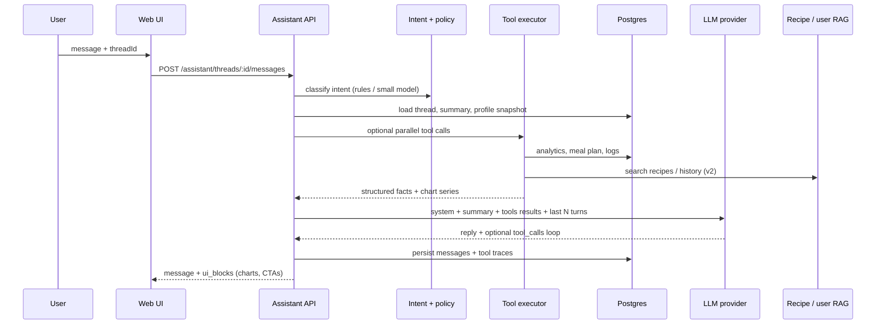

# Architecture — AI Wingman

## High-level flow



## Layers (not three separate LLMs)

| Layer | Responsibility | Technology |
|-------|----------------|------------|
| **Facts** | Calories, deficits, trends, plan state | Existing Nest services + SQL |
| **Retrieval** | Recipes, (later) past insights / meals | Embeddings + filters (existing RAG) |
| **Reasoning** | Coaching tone, synthesis, follow-ups | One primary chat model |
| **Orchestration** | Tool loop, policy, memory | Assistant module in API |
| **Presentation** | Chat UI, embedded charts | React; chart specs from API |

### Optional “analyst”

Use **code + SQL** first. Add a **cheap classifier** (rules or mini model) only for intent: `progress_question` | `nutrition_coach` | `wellness_coach` | `action` | `off_topic`.

## Memory model

| Type | Storage | Used for |
|------|---------|----------|
| Working | Last 10 messages in prompt | Exact follow-ups |
| Thread summary | `AssistantThread.summary` (LLM or rule, 12+ messages) | Long conversations |
| Authoritative facts | Profile snapshot injected each turn | Goals, restrictions, targets |
| Cross-session | `AssistantUserMemory` (narrative + facts JSON) | Preferences across threads — see [LONG_TERM_MEMORY.md](./LONG_TERM_MEMORY.md) |

**Rule:** Summaries and memory are narrative only; metrics must be re-fetched via tools each turn if needed.

## Tool catalog (shipped)

| Tool | Source | Example question |
|------|--------|------------------|
| `get_health_metrics` | profile + analytics | “What’s my BMI?” |
| `get_progress_summary` | analytics | “How close to my goal?” |
| `get_meal_plan` | meal-plans | “What’s for dinner today?” |
| `get_recipe` | recipes | “How do I prepare tonight’s meal?” |
| `get_nutrition_summary` | nutrition-analytics | “Calories today vs target?” |
| `search_recipes` | recipes + RAG | “High protein lunch ideas” |
| `get_chart_data` | analytics | “Show my weight trend” → `ui_blocks` chart |
| `get_daily_check_in` | daily-wellness | Sleep, water, mood, steps (day or week) |
| `update_nutrition_targets` | nutrition | Set calorie/macro targets (AI, formula, or manual); returns `recommendationRationale` when applicable |
| `update_nutrition_preferences` | nutrition | Meals/snacks per day and `preferred_meal_times` (incl. `snack_2`) |
| `update_health_profile` | profile | Age, height, weight, activity, goals (e.g. onboarding) |

**Daily wellness (Overview):** `GET /today`, habits check-in (`PUT` incl. optional steps), quick food log — see [DAILY_WELLNESS.md](./DAILY_WELLNESS.md). Seven-day check-in habits can add a **Check-in** wellness component (~12.5% when data exists).

**Meal photos (bonus):** Gemini vision → `MealPhotoScan` → user confirm → `MealIntakeLog` → analytics ([MEAL_PHOTOS.md](./MEAL_PHOTOS.md)).

**Onboarding:** scripted setup in chat — [WINGMAN_ONBOARDING.md](./WINGMAN_ONBOARDING.md).

**Confirmed writes (UI, not silent tools):** `confirm_log_activity`, `confirm_log_weight`, `confirm_regenerate_meal`, `confirm_generate_shopping_list`, `confirm_mark_meal_eaten`, `confirm_generate_meal_plan`, and `confirm_onboarding_*` (see onboarding doc). Rule-parsed weight/activity and meal-plan actions still require explicit confirm before DB writes.

## Response shape

```typescript
type AssistantMessage = {
  id: string
  role: 'user' | 'assistant' | 'tool'
  content: string
  uiBlocks?: Array<
    | { type: 'chart'; chart: 'calorie_trend' | 'macro_pie' | 'deficit_line'; params: Record<string, unknown> }
    | { type: 'cta'; label: string; action: 'open_nutrition' | 'open_insights' | 'confirm_regenerate_plan' }
  >
  toolTraces?: Array<{ name: string; args: unknown; resultSummary: string }>
}
```

## Deployment shape (this repo)

**Chosen:** assistant as a Nest module in the existing API (`apps/api/src/assistant/*`) plus a chat panel in `apps/web`. One clone for reviewers, shared auth and Prisma.

See [INTEGRATION.md](./INTEGRATION.md) and [REVIEWER_SETUP.md](./REVIEWER_SETUP.md).

## Safety

- No medical diagnosis; wellness disclaimers.
- Rate limit per user + per thread.
- Log prompts/responses without raw PII (user id only).
- Fallback when LLM down: template answers from last cached analytics.
