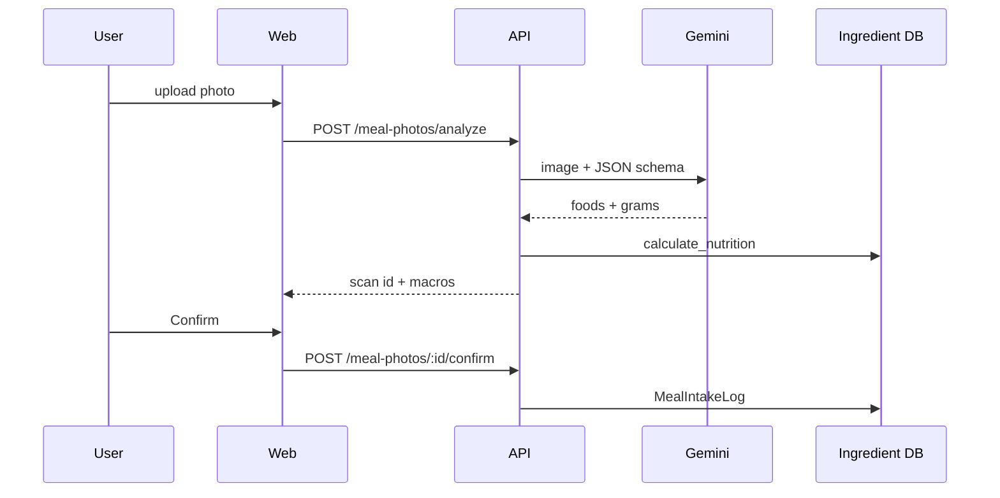

# Meal photos (Gemini vision)

## Flow

1. User uploads a meal photo on the **Nutrition** tab.
2. **Gemini** returns food names and estimated grams only (no calories).
3. API matches ingredients to the **nutrition database** and calculates macros.
4. User **confirms** → row in `MealIntakeLog` → included in daily analytics.



## API

| Method | Path | Description |
|--------|------|-------------|
| POST | `/api/meal-photos/analyze?date=&mealType=` | `multipart/form-data` field `image` |
| GET | `/api/meal-photos/:scanId` | Scan details |
| POST | `/api/meal-photos/:scanId/confirm` | Log intake |
| GET | `/api/meal-photos` | Recent scans |

## Environment

```env
GEMINI_API_KEY=
GEMINI_VISION_MODEL=gemini-2.0-flash
MEAL_PHOTO_MAX_BYTES=5242880
```

## Data model

- `MealPhotoScan` — analysis result (not counted until confirmed)
- `MealIntakeLog` — confirmed intake; summed with eaten planned meals in `nutrition-analytics`

## Safety

- Unmatched foods are listed and excluded from totals.
- Images are not stored permanently (processed in memory only).
- Requires JWT; per-user isolation.
